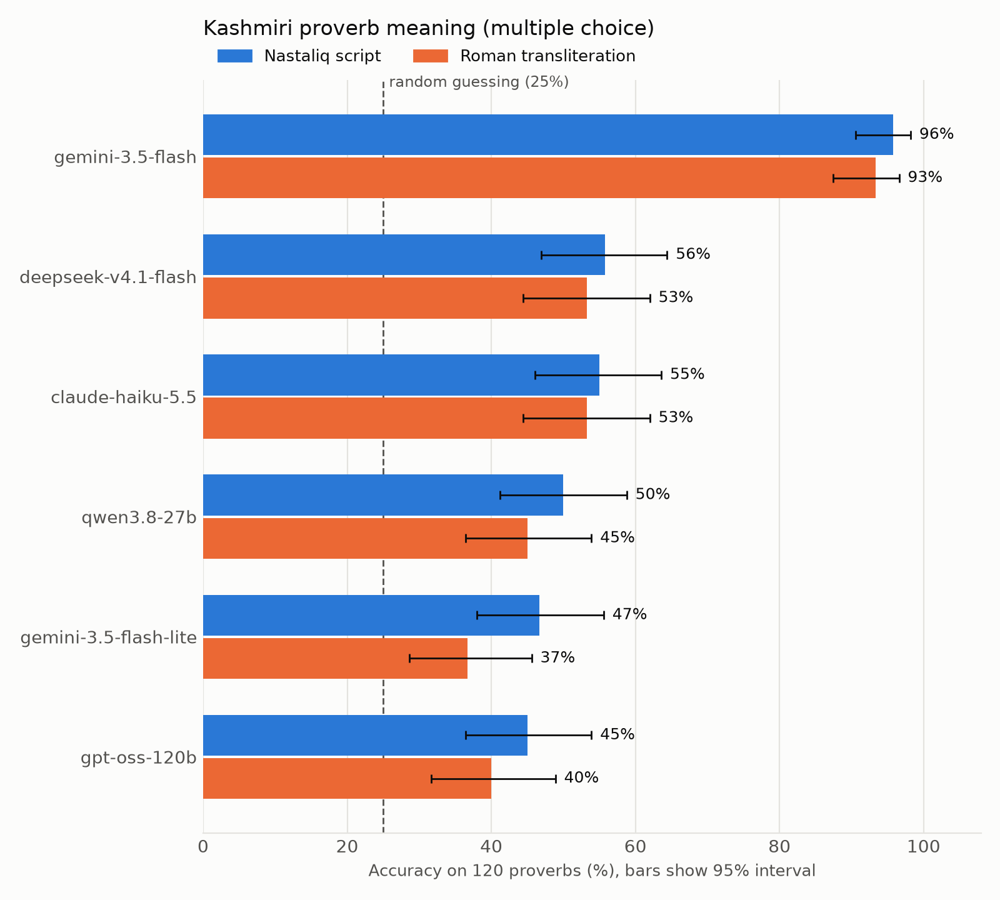

# Kashmiri Proverb Evaluation

The first benchmark of Kashmiri proverbs in Nastaliq script, and an evaluation of large language models on proverb understanding.

[](https://doi.org/10.5281/zenodo.24169347)

> **Permanent archive on Zenodo:** [https://doi.org/10.5281/zenodo.24169347](https://doi.org/10.5281/zenodo.24169347)
> Cite this DOI to refer to the exact dataset, code and results used in the paper.

---

## What this is

Kashmiri is a low-resource language written mainly in Perso-Arabic (Nastaliq) script. This repository contains:

- a dataset of **120 Kashmiri proverbs** with Nastaliq text, Roman transliteration, English meaning and idiomatic context;
- a **four-option multiple-choice test** built from the dataset;
- the **evaluation scripts** and **raw model answers** behind the paper.

Each proverb is tested twice, once in Nastaliq and once in Roman transliteration. The random baseline is 25%.

## Data source and status

- The proverbs come from J. Hinton Knowles, *A Dictionary of Kashmiri Proverbs and Sayings* (Bombay, 1885), which is in the public domain.
- The Nastaliq text, English meanings and idiomatic context were written by the author. The Roman transliteration keeps diacritics and is adapted from Knowles's romanization.
- **The Nastaliq has not yet been reviewed by independent native speakers.** Errors or spelling variants may remain. Corrections are welcome through issues or pull requests.

## Results

Multiple-choice accuracy on 120 proverbs. Only the first reply is scored. Intervals are 95% Wilson confidence intervals.

| Model | Nastaliq | Roman |
|---|---|---|
| Gemini 3.5 Flash | 95.8% [90.6, 98.2] | 94.2% [88.4, 97.1] |
| DeepSeek (`deepseek-v4.1-flash`) | 55.8% [46.9, 64.4] | 54.2% [45.3, 62.8] |
| Gemini 3.5 Flash-Lite | 55.0% [46.1, 63.6] | 55.0% [46.1, 63.6] |
| Claude Haiku (`claude-haiku-5-5`) | 55.0% [46.1, 63.6] | 53.3% [44.4, 62.0] |
| Qwen (`qwen3.8-27b`) | 50.0% [41.2, 58.8] | 45.0% [36.4, 53.9] |
| gpt-oss-120b | 45.0% [36.4, 53.9] | 40.0% [31.7, 48.9] |

**Figure: accuracy by model and script (95% confidence intervals, dashed line = 25% chance)**



Main findings:

- One model, Gemini 3.5 Flash, scores about 95% in both scripts. The other five score between 40% and 56%.
- Differences between Nastaliq and Roman are small and inside the confidence intervals.
- Gemini 3.5 Flash-Lite often gave no clear letter on its first reply (31 of 120 in Nastaliq, 19 in Roman). The chart also shows a letter-only variant (`gemini-3.5-flash-lite-enum`) where the API only allows the reply A, B, C or D.

### Caveats

- Models ran with different reasoning settings, so the table is not a controlled ranking.
- Knowles (1885) is available online and may be in some models' training data, which could inflate scores.
- 120 proverbs from a single historical source is a small sample.
- Each condition was run once at temperature 0.

## Repository layout

```
data/       kashmiri_proverbs.csv, mcq_test_set.csv
scripts/    run_eval.py
analysis/   score.py, plot.py, audit.py, restore.py
results/    raw answers (mcq_<model>_<script>.csv), summary_mcq.csv, figure_mcq.png/.pdf
paper/      main.tex
```

## Reproducing the results

Python 3 is required. Set the API key for the provider you use as an environment variable (never commit keys), then:

```bash
# run one model on one script; repeat with --mode roman
python scripts/run_eval.py --provider gemini --model gemini-3.5-flash --mode nastaliq

# score and plot
python analysis/score.py --no-rescue
python analysis/plot.py
```

`run_eval.py` supports the providers `gemini`, `groq`, `openrouter` and `openai`. Useful options: `--limit N` (run in batches), `--sleep S`, `--max-tokens`, `--effort`, `--enum` (Gemini letter-only mode), `--rescue` (one follow-up question when the first reply has no clear letter).

A reply counts only if it contains a clear final letter. Unclear replies are scored wrong and never guessed.

## Licence

- Code: MIT.
- Data (`data/`): CC BY 4.0.

## Citation

```bibtex
@misc{bazaz2026kashmiri,
  title  = {A Benchmark of Kashmiri Proverbs in Nastaliq Script for Evaluating Large Language Models},
  author = {Bazaz, Ahmed Bin Ajaz},
  year   = {2026},
  doi    = {10.5281/zenodo.24169347},
  url    = {https://doi.org/10.5281/zenodo.24169347}
}
```

Source code: <https://github.com/ahmed-ajaz17/Kashmiri-Proverb-Evaluation>

Please also cite the original source: J. Hinton Knowles, *A Dictionary of Kashmiri Proverbs and Sayings*, Bombay: Education Society's Press, 1885.
